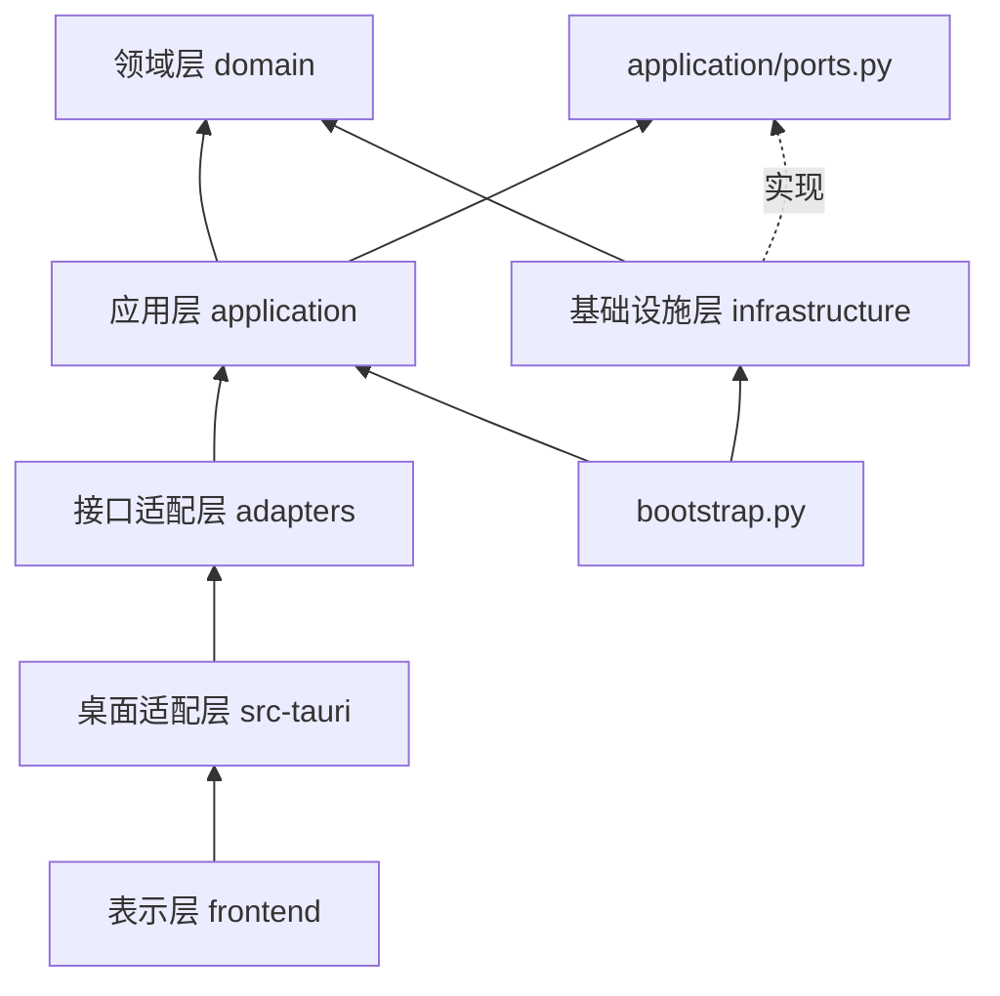

# 分层设计

目标：换界面不碰串口逻辑，换设备不碰页面，测试不需要硬件。依赖只能从外层指向内层，
`tests/test_layering.py` 用 AST 检查导入方向。

## 六层职责

| 层 | 位置 | 负责 | 不做 |
| --- | --- | --- | --- |
| 表示层 | `frontend/src/` | 页面、表单、加载/空/运行中/取消中/成功/失败状态、轮询、确认对话框 | 串口、数据库、文件、计算、最终校验（HTML 约束只做即时反馈） |
| 桌面适配层 | `src-tauri/src/main.rs` | 窗口、sidecar 启动/监测/关闭、令牌、`api_request` 白名单、`reveal_export` | 协议、计算、数据访问、任意 shell/URL/文件 |
| 接口适配层 | `adapters/api/server.py`、`adapters/cli/main.py` | 鉴权、请求解析与类型转换、调用用例、异常→错误码 | 直接操作串口或拼接 SQL |
| 应用层 | `application/` | `ExperimentRunner`（流程、互斥、取消、配气/温度模式）、`TaskRegistry`、配方/历史/分析/设备用例、`ports.py` | 导入 Svelte/Tauri/HTTP/串口/SQLite 库；自行创建真实连接 |
| 领域层 | `domain/` | `RecipeStep` 校验、`ExperimentEngine` 状态机、报警/联锁字解码、失重法 `compute_reduction`、`check_gas_mode_switch` | 文件、网络、数据库、设备、线程、HTTP 状态码、UI 文案依赖、环境默认值 |
| 基础设施层 | `infrastructure/` | SQLite 存储、设备网关与钉定驱动、CSV/Excel/报告写入、JSON 配置、路径、日志 | 反向依赖 UI、桌面壳或 API |

## 依赖方向

## 组合根与依赖注入

`bootstrap.build_container()` 是唯一创建具体实现的地方：

1. `AppPaths` 决定用户数据目录；`load_config()` 读取 JSON（首次导入旧 `.env`）。
2. `DatabaseManager` 打开 SQLite 并建表/迁移；`Sqlite*Store` 实现 `RecipeStore / ExperimentStore / AlarmStore / AuditStore`。
3. `build_gateway()` 依据 `device_backend` 创建 `PlcModbusGateway` 或 `MultiDeviceExperimentGateway`（实现 `ExperimentGateway`）。
4. `ExperimentRunner`、`TaskRegistry`、`RecipeService`、`HistoryService`（注入 `Exporter`）、`AnalysisService`
   （注入 `ReportWriter`）、`DeviceService` 组成 `AppContainer`。

测试用 `tests/conftest.py` 的 `FakeGateway` 和临时目录中的 SQLite 替换真实实现；API 测试也通过
`build_container(..., gateway=FakeGateway())` 注入，不触碰串口。

## 业务规则放置

| 规则 | 位置 |
| --- | --- |
| 配方步骤范围（温度 0–1600 ℃、流量 0–50 L/min、步骤 ≤ 32、名称长度） | `domain/recipe.py` |
| 步骤完成判定、升温/总超时、暂停/中断语义 | `domain/experiment_engine.py` |
| 报警位、联锁位、急停、可复位判定 | `domain/alarm_rules.py` |
| 还原度、速率、t40/t60 | `domain/kinetics.py` |
| 运行中切换配气模式需确认 | `domain/control.py` |
| 单实验互斥、停止=请求、终态在落库后、设备无响应故障、手动配气范围 | `application/experiment_runner.py` |
| 任务去重、取消→cancelling→cancelled、历史上限 50 | `application/tasks.py` |
| 配方正在运行不可改/删；运行中不可删实验、不可手动控制设备 | `application/recipe_service.py`、`history_service.py`、`device_service.py` |
| 配方→TAIE 程序段映射（升温段 + 保温段，≤ 8 段） | `infrastructure/gateways.py` |
| 协议帧、CRC、CPL 校验、量程换算、重试 | `infrastructure/comm/` |
| loopback、令牌、请求体上限、错误码 | `adapters/api/server.py`；IPC 白名单在 `src-tauri/src/main.rs` |

页面只渲染 Python 返回的 `status`、`allowed`、`alarm.text` 等字段，不根据原始字重新判定。

## 新增功能的步骤（示例：新增一种导出格式）

1. 领域/应用：在 `HistoryService.EXPORT_KINDS` 增加种类，在 `ports.Exporter` 声明写入方法。
2. 基础设施：在 `infrastructure/exports/export_service.py` 实现写入（原子替换），补 `tests/test_services.py`。
3. 接口：`adapters/api/server.py` 无需改路由（`POST /api/experiments/{id}/export` 已接受 `kind`），更新 `docs/api.md`。
4. 桌面：若无新路径，`src-tauri` 不改；新增路径才扩展白名单（同时更新 Rust 与文档）。
5. 表示：在 `frontend/src/lib/api/endpoints.ts` 增加类型与函数，在历史页加按钮并复用任务进度组件。

新增设备协议同理：先在 `infrastructure/comm/` 写驱动与帧测试，实现 `ExperimentGateway`，在 `bootstrap.build_gateway()`
中按配置选择；不改 Rust，不在 Svelte 中复制寄存器语义。

## 测试与各层对应

| 风险 | 测试 |
| --- | --- |
| 配方越界、文件格式 | `tests/test_recipe_domain.py` |
| 步骤判定、超时、暂停/中断 | `tests/test_experiment_engine.py` |
| 报警/联锁字、寄存器映射、Modbus 编解码 | `tests/test_alarm_rules.py`、`test_device_map.py`、`test_modbus_client.py` |
| 还原度计算、报告 | `tests/test_kinetics.py`、`test_report_service.py` |
| 运行生命周期、取消、终态落库、配气模式确认、设备无响应 | `tests/test_experiment_runner.py` |
| 任务取消语义、去重、历史上限 | `tests/test_tasks.py` |
| 用例守卫与导出格式 | `tests/test_services.py` |
| SQLite 表结构与升级 | `tests/test_database.py`、`test_migrations.py`、`test_history_queries.py` |
| 配置原子写入、未知字段、旧 `.env` 导入 | `tests/test_config_and_paths.py` |
| loopback、令牌、请求体、错误码、握手、stdin EOF | `tests/test_api.py` |
| 多设备网关降级与仿真/真实适配器 | `tests/comm/` |
| 导入方向 | `tests/test_layering.py` |
| 版本一致性与发布脚本 | `tests/test_release_tooling.py`、`test_version_single_source.py` |
| 前端连接重试上限、后端退出态、双击防重复、取消中状态 | `frontend/src/lib/state/*.test.ts` |
| 冻结后端、窗口启动/退出、安装/卸载、进程残留 | `.github/workflows/checks.yml` 与 `scripts/smoke_*.{py,ps1}` |
