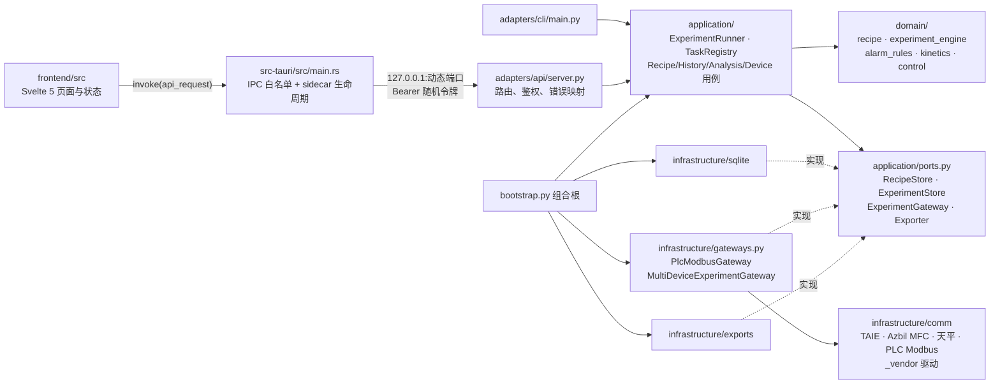
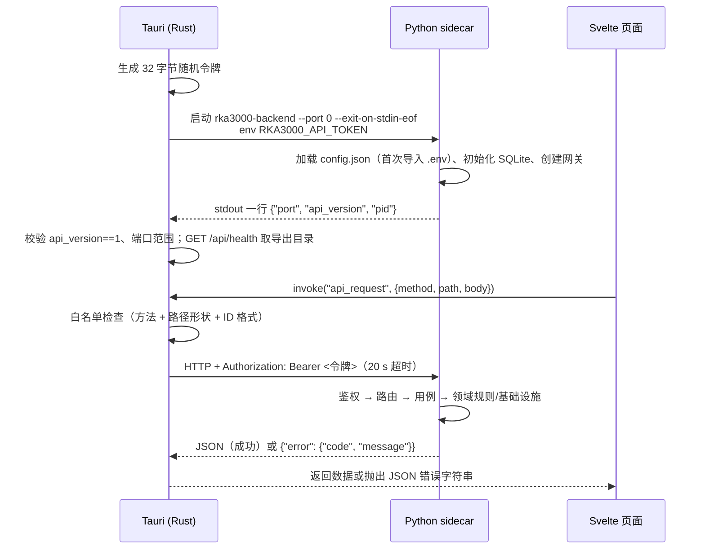
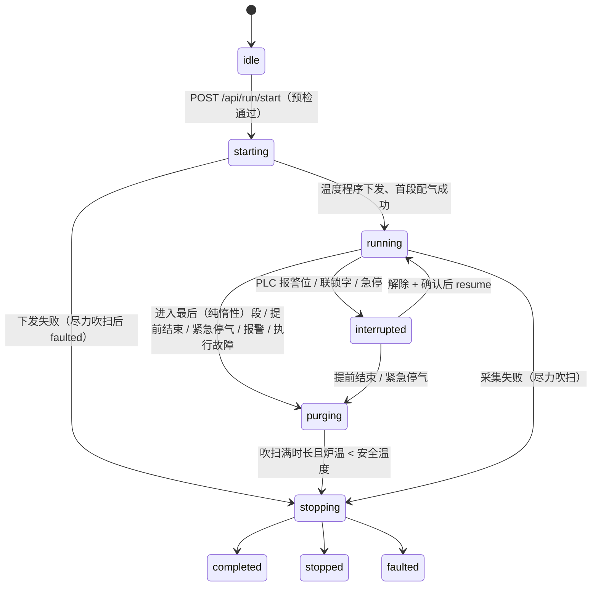
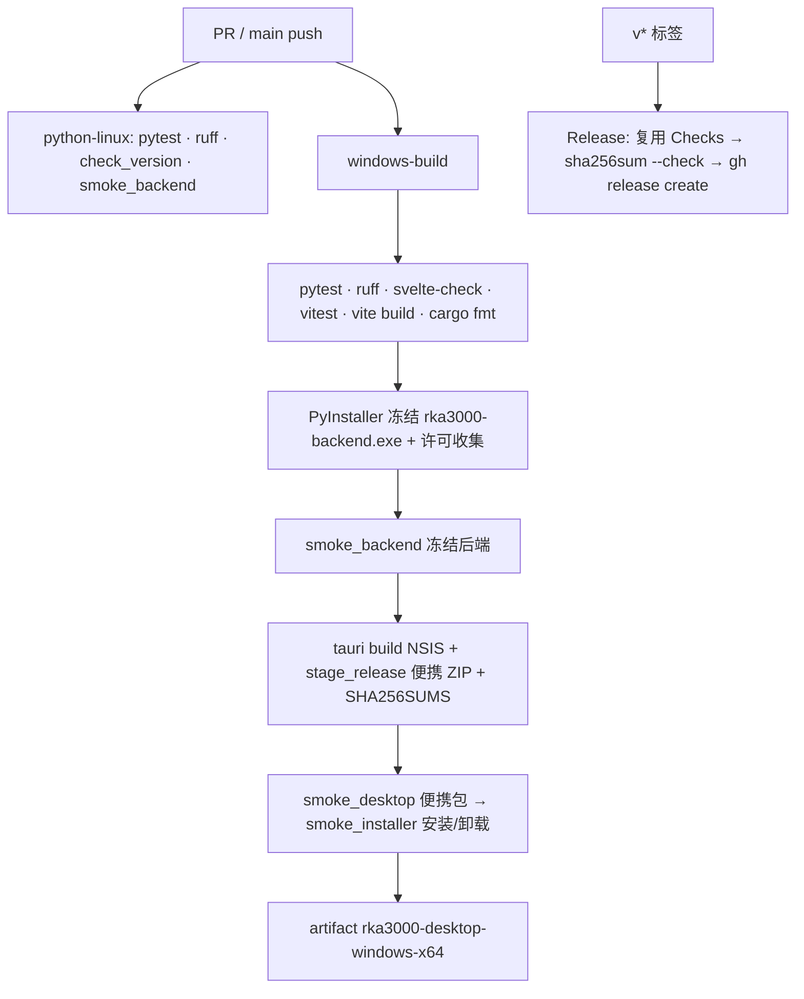

# 技术架构

RKA-3000 上位机由三部分组成：**Svelte 5 / TypeScript 页面**负责展示与交互，**Tauri 2 Rust 壳**负责窗口、
Python 进程生命周期与受限 IPC，**Python 后端**拥有全部业务、数据、计算与设备通信。页面不直接访问串口、
数据库或文件；Rust 不实现协议、计算或数据访问。

## 组件关系

| 组件 | 位置 | 职责 |
| --- | --- | --- |
| 页面与状态 | `frontend/src/features/*`、`lib/state/*.svelte.ts` | 表单、轮询、任务进度、确认对话框；展示状态 |
| 类型化 API 客户端 | `frontend/src/lib/api/` | Tauri IPC 或浏览器同源代理两种传输，统一错误解析 |
| 桌面壳 | `src-tauri/src/main.rs` | 启动/监测/关闭 sidecar，持有令牌，`api_request` 白名单，`reveal_export` 受限打开导出目录 |
| API 适配 | `src/rka_desktop/adapters/api/server.py` | loopback、令牌、1 MB 请求体、路由表、错误码映射、stdin EOF 收尾 |
| CLI 适配 | `src/rka_desktop/adapters/cli/main.py` | `api`、`paths`、`import-legacy-db`、`recipes`、`export`、`kinetics` |
| 应用层 | `src/rka_desktop/application/` | 实验运行用例与采集线程、任务注册表、配方/历史/分析/设备用例、端口声明 |
| 领域层 | `src/rka_desktop/domain/` | 配方校验、执行引擎状态机、报警/联锁字解码、失重法动力学、控制模式规则 |
| 基础设施 | `src/rka_desktop/infrastructure/` | SQLite 存储、设备网关与驱动、CSV/Excel 导出与报告、JSON 配置、路径、日志 |
| 组合根 | `src/rka_desktop/bootstrap.py` | 读取配置、选择设备通路、创建存储与用例、`AppContainer` |

## 启动与请求路径

- 页面在浏览器开发模式下改走 Vite 同源代理 `/api`，令牌由 Vite（Node 侧）与 Python 读取，不进入前端包。
- Rust 的白名单不包含 `/api/shutdown`；该接口只在退出时由 Rust 调用。
- 令牌不写入日志：Python 日志过滤器把 `Bearer …` 替换为 `[redacted]`，测试断言令牌不出现在日志中。

## 进程生命周期

| 阶段 | 行为 |
| --- | --- |
| 启动 | 开发构建：`RKA3000_PYTHON` 或仓库 `.venv`，否则同目录 sidecar；**不回退**到 PATH 上的 Python。发布构建：只运行同目录 `rka3000-backend.exe`。等待握手最多 30 s；握手格式、端口范围、接口版本不符或进程提前退出均视为失败，杀死子进程，窗口仍打开并显示原因，诊断写 `desktop.log`。无法创建窗口（缺 WebView2）时 Windows 弹出系统错误框。 |
| 运行 | Rust 每 500 ms 探测子进程存活；退出后 `backend_status` 报告 `exited`，`api_request` 返回 `backend_exited`，页面停止重试并提示重启。瞬时失败按指数退避最多重试 10 次后进入“不可用”，提供手动重试。页面不会自动重放业务请求。 |
| 关闭 | 窗口退出 → Rust `POST /api/shutdown` → Python 停止接受请求、`ExperimentRunner.close()`（终止实验、等待采集线程、落库、关闭设备）、`TaskRegistry.close()` → 进程退出。Rust 同时关闭 stdin 管道作为备用信号，最多等待 90 s，超时才强制结束并记录。 |
| 桌面异常退出 | 后端以 `--exit-on-stdin-eof` 启动并持有 Rust 的 stdin 管道写端；桌面崩溃或被结束任务时操作系统关闭管道，Python 读到 EOF 后执行与 shutdown 相同的收尾。PyInstaller onefile 的引导进程与业务进程随之一起退出；CI 的桌面冒烟检查窗口退出后无残留 `rka3000-backend` 进程。 |
| 无法保证 | 断电、后端自身被强杀：最后的设备命令（如停机）可能未送达，现场仍需硬件安全联锁。 |

## 实验运行模型

- 终态后实验进入“待核查”，复核归档后才能开始下一次实验；见 [experiment-lifecycle.md](experiment-lifecycle.md)。
- `stopping` 表示终态已决定但采集线程尚未刷写缓冲测量数据；只有刷写完成才进入终态，终态不会被迟到的请求改写。
- 配气模式 `auto`：阶段切换时下发该阶段全部气体并读回 MFC 设定；`manual`：操作者通过 `/api/run/manual-gas`
  下发（原因必填、三态确认、回读不一致回退）。运行中切换必须 `confirm: true`。
- 温度模式 `program`：启动时把每个阶段映射为 TAIE 的升温段 + 保温段写入程序组（最多 8 段 = 4 阶段），过程中不写温度；
  阶段跟随仪表当前运行段（`SEG`）。`setpoint`：每阶段写 SP 与升温速率（PLC contract_v1）。
- 软件报警规则（`domain/safety.py`）每个采样评估；回读过期不停机，只是该段不入库并禁止控制。
- 实验、测量（含 `phase`）、报警、审计、配方版本、使用上限策略、报告记录写入 SQLite（schema v3）；
  运行快照与最近 3600 个采样点保留在内存供页面轮询。

## 数据与安全边界

- 用户数据目录见 README；配置 JSON 原子写入，未知字段报错，损坏文件保留不覆盖。
- API 只绑定 127.0.0.1；令牌缺失或错误返回 401；请求体 > 1 MB 返回 413；连接 10 s 超时；
  测量分页上限 5000 条；日志返回最后 256 KB。
- 随机令牌不是本机进程隔离的充分防护，因此同时落实 IPC 白名单（方法、路径形状、ID 格式）、
  Tauri `core:default` 最小 capability、CSP 只允许 `self` 与 IPC。
- 带副作用的接口（启动/停止、模式切换、手动配气、设备写入、去皮、删除）独立于状态查询，需要操作员触发与确认；
  自动轮询只调用 GET 接口。

## 构建与分发

发布资产：NSIS 安装器、便携 ZIP、`SHA256SUMS.txt`，随包 `notices/` 含第三方许可与依赖清单。未配置代码签名
与自动更新。详细命令见 [releasing.md](releasing.md)。
