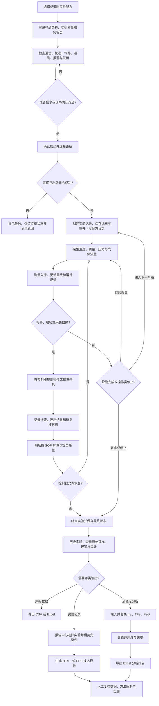

# RKA-3000 实验与报告流程图

下图对应当前桌面程序的可执行流程。人工预检只记录操作员确认；真机的独立急停、供气处置和联锁验收仍按现场 SOP 执行。

## 报告边界

- HTML/PDF **技术记录**从所选历史实验读取实验信息、完整原始采样和报警；运行中、故障或无采样的记录会明确标记不完整。
- Excel **分析报告**需要先在数据分析页计算还原度；参数或实验选择变化后，旧结果失效，必须重新计算。
- 当前数据库尚无启动时配方快照、正式数据质量判据、方法版本和电子审签。生成的文件均不能直接视为经批准的正式试验报告。
