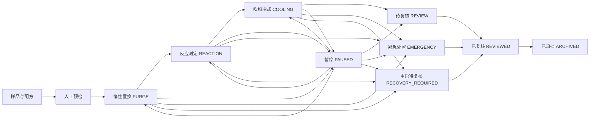

# 新版桌面仿真流程与接口

新版桌面窗口使用 Tauri 2 + Svelte 5/TypeScript；Python 子进程是业务状态、校验、采样、分析及报告的唯一来源。当前接口强制 `simulation_mode=True`，不包含真实设备写入命令。原 PySide6 程序仍是现有完整实验入口。

## 数据边界

- 新版使用现有 SQLite 文件中的 `sim_*` 独立表：配方版本、实验、采样、报警、审计、设置及旧库导入来源。旧版 `recipes`、`experiments` 等表保持原结构。
- 每次配方保存创建新版本；实验启动时复制完整配方阶段和七气体参数，此后编辑配方不会改变该实验。
- 七气体对应六台 MFC：N₂ / Ar 共用 MFC-01；CO、CO₂、H₂、CH₄、O₂ 分别对应 MFC-02 至 MFC-06。N₂ 与 Ar 不可在同次实验并用。还原禁用 O₂；氧化禁用 CO / H₂ / CH₄。
- 使用上限由仿真管理员在所有实验已归档时修改，且不得超过标称设备上限；配方保存与启动时都由 Python 重验。角色切换仅为仿真演示。

## 状态转换



暂停、报警及离线场景不继续推进阶段；界面不把旧采样作为实时有效值。紧急处置不能恢复，只能由复核员记录结论后归档。应用重启时活动实验标记 `RECOVERY_REQUIRED`，不自动续行。仿真工作线程每秒采样一次，UI 每 2 秒读取快照；设备状态诊断接口首次读取并约每 30 秒复查，未配置现场设备时真实状态始终为 `unknown`。

## JSONL 桥接

每行请求为 `{ "id": 1, "method": "sim_bootstrap", "params": {} }`，响应为 `{ "id": 1, "ok": true, "result": ... }`。失败返回 `INVALID_REQUEST`、`WORKFLOW_CONFLICT` 或 `BACKEND_ERROR`。Tauri 在异步命令中将请求交给专用线程，不在 UI 线程阻塞等待串口或 Python 计算。

| 类别 | 方法 |
| --- | --- |
| 初始与诊断 | `sim_bootstrap`, `sim_snapshot`, `sim_devices_status` |
| 配方 | `sim_recipes`, `sim_recipe`, `sim_recipe_save` |
| 实验 | `sim_preflight`, `sim_run_start`, `sim_run`, `sim_run_action`, `sim_history`, `sim_samples`, `sim_run_events` |
| 结果 | `sim_analysis`, `sim_report` |
| 追溯 | `sim_alarms`, `sim_alarm_ack`, `sim_alarm_clear`, `sim_audit` |
| 设置与导入 | `sim_settings`, `sim_settings_update`, `sim_import_legacy`, `sim_legacy_runs`, `sim_legacy_samples`, `sim_legacy_recipes`, `sim_legacy_audit` |

`sim_samples` 支持 `limit`（最大 1000）、`offset`、`stride` 和 `tail`，历史趋势按需读取并抽稀；首页不加载完整采样。快照包含采样时间、状态、失效原因和可空值。首次无采样为 `unknown`，超过 8 秒或安全处置状态为 `stale`，故障为 `offline`。

## 旧库导入与报告

设置页的显式导入向导以只读方式打开旧 SQLite 文件。先校验旧表并备份当前工作库，再复制配方、阶段、实验、原始采样、报警和审计，记录源文件 SHA-256。原始采样逐条保存和分页读取，避免把长曲线放进历史列表。相同文件重复导入直接返回原导入记录，旧文件不修改。导入前请关闭旧版程序，确保 SQLite WAL 写入已合并。旧库记录单独显示，不自动转换为七气体配方。

桌面桥接的普通读取和控制命令限时 5 秒；分析与报告限时 30 秒，显式旧库导入限时 300 秒。超时会停止后端进程并提示重新启动应用，避免卡住界面。

Python 生成 HTML 技术记录，包含配方快照、采样摘录、报警及审计。摘录最多 200 点，标明抽稀倍数和总数；完整数据在历史页分页查看。有效采样的首末质量差仅作仿真趋势指标，不能代替化学计量还原度或氧化率。PDF 由独立 Tauri 报告窗口调用系统打印对话框保存，正式审签仍需人工完成。

## 本地验证

```bash
.venv/bin/python -m pytest -q
cd frontend
npm ci
npm run check
npm run build
cd src-tauri && cargo check
```

Windows 安装包使用 `scripts/packaging/build_tauri_windows.ps1` 在 Windows 本机或手动触发 `tauri-windows-smoke` 工作流构建。macOS 使用 `scripts/packaging/build_tauri.sh`。没有现场串口及硬件联锁数据时，以上仅为离线仿真验证。
